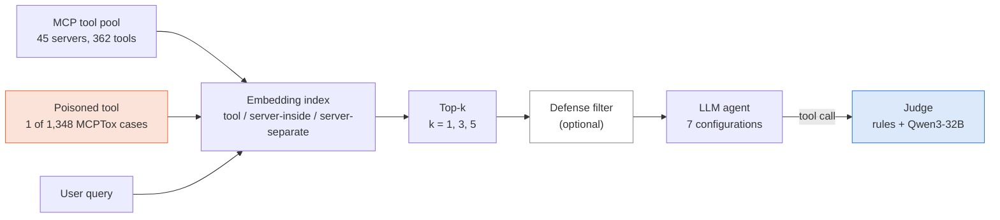
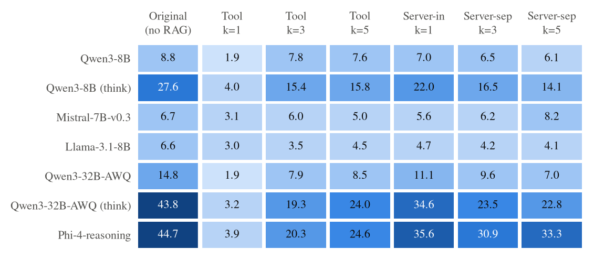
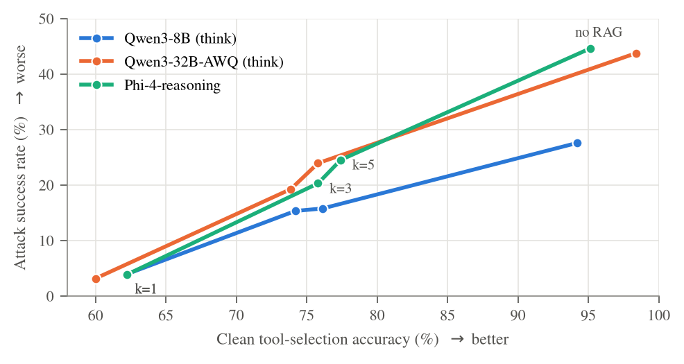
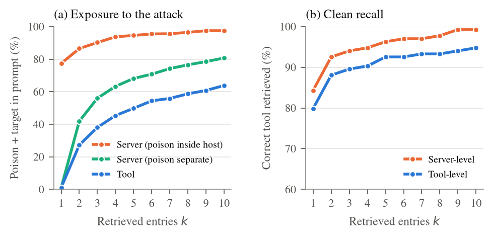

# Is RAG-MCP Safe Against Tool Poisoning?

**Retrieval narrows, but does not close, the attack surface of MCP agents.**

[RAG-MCP](https://arxiv.org/abs/2505.03275) proposes retrieving only the relevant MCP tools for each query instead of putting every tool description in the prompt. This saves tokens and improves tool selection. We ask whether retrieval also protects the agent from **tool poisoning**. In this attack, a malicious tool description hides instructions that make the agent misuse a *different*, legitimate tool.

We re-implement RAG-MCP and attack it with all 1,348 poisoning cases of the [MCPTox](https://arxiv.org/abs/2508.14925) benchmark. We evaluate 7 model configurations, 3 retrieval granularities and several values of *k* (312,736 judged case–setting pairs), together with an adaptive attack and a simple defense.

## Key findings

- **Top-1 tool retrieval nearly removes the attack**: attack success drops from 6.6–44.7% to 1.9–4.0%. The cost is about 33 points of clean tool-selection accuracy.
- **At useful *k*, the attack survives.** With 5 retrieved tools, the poison still reaches the prompt in 69% of cases, and up to a quarter of attacks on reasoning models succeed.
- **Server-level retrieval (RAG-MCP's design) barely helps** against a compromised server. The poison travels with its host server, and reasoning models keep about 80% of their original attack success.
- **Retrieval filters, it does not sanitise.** Once the poison is in the prompt, models follow it about as often as without retrieval.
- **Retrieval hides descriptions, not tools.** At top-1, 149 of 150 successful attacks on reasoning models called a tool that was *never shown* to the model. The poison only named it.
- **Reasoning ("thinking") roughly triples attack success**, without improving tool selection.
- **A cheap filter after retrieval helps a lot.** Attack success falls to ≤ 2.2% (≤ 5.1% for LLM-rewritten poisons), at a cost of 1–6 accuracy points.

## How it works



For each MCPTox case, the poisoned tool is added to an embedding index of the 362 clean tools. The case's user query retrieves the top-*k* entries. We compare three index designs:

| Setting | Index entry | Where the poison lives | Models |
|---|---|---|---|
| `original` | none (no retrieval) | inside the host server's prompt, as in MCPTox | the baseline |
| `tool@k` | one tool | one extra tool entry | fine-grained retrieval |
| `server-inside@k` | one server (scored by its best tool) | inside its host server | a compromised server (RAG-MCP's design) |
| `server-separate@k` | one server | its own one-tool server | a malicious server registered by the attacker |

Each response is labelled `Success`, `Direct`, `Ignored`, `Refused` or `None`. Cheap rules come first, then a Qwen3-32B judge. The judge agrees with MCPTox's own labels on 97.1% of 1,500 responses (Cohen's κ = 0.94), and with a blind human check on all 100 sampled responses.

## Results

**Attack success rate (%)** on all 1,348 cases. The retriever is bge-small.

| Model | Original | Tool k=1 | Tool k=5 | Server-inside k=1 | Server-separate k=5 | Original + defense |
|---|---:|---:|---:|---:|---:|---:|
| Qwen3-8B | 8.8 | 1.9 | 7.6 | 7.0 | 6.1 | 0.3 |
| Qwen3-8B (thinking) | 27.6 | 4.0 | 15.8 | 22.0 | 14.1 | 0.8 |
| Mistral-7B-Instruct-v0.3 | 6.7 | 3.1 | 5.0 | 5.6 | 8.2 | 0.3 |
| Llama-3.1-8B-Instruct | 6.6 | 3.0 | 4.5 | 4.7 | 4.1 | 0.1 |
| Qwen3-32B-AWQ | 14.8 | 1.9 | 8.5 | 11.1 | 7.0 | 0.4 |
| Qwen3-32B-AWQ (thinking) | 43.8 | 3.2 | 24.0 | 34.6 | 22.8 | 1.3 |
| Phi-4-reasoning | 44.7 | 3.9 | 24.6 | 35.6 | 33.3 | 2.2 |
| *Poison in the prompt* | *100* | *23.6* | *69.2* | *77.4* | *79.1* | |



**No retrieval setting is both accurate and safe.** Fewer retrieved tools means fewer attacks, but also more wrong tool choices.



**Why:** the poison is written about the same task as its target, so retrievers find it. A stronger retriever finds it more often.



All numbers for every run are in [`results/REPORT.md`](results/REPORT.md).

## Quick start

### Requirements

- Linux with an NVIDIA GPU and CUDA drivers. We used one **A40 (46 GB)**. The 7–8B models should fit in 24 GB; Qwen3-32B-AWQ and Phi-4-reasoning need about 40 GB.
- About **115 GB of disk** for model weights (downloaded automatically from Hugging Face on first use).
- [uv](https://docs.astral.sh/uv/) (recommended) or Python 3.12.
- For Llama-3.1-8B (gated): accept its licence on Hugging Face, then run `hf auth login`. The pipeline skips Llama if access is missing.

### Install and run

```bash
git clone https://github.com/NivedKris/FLLM-PROJECT.git
cd FLLM-PROJECT
./run.sh --setup          # Python 3.12 environment + packages
./run.sh --data           # download the MCPTox benchmark into data/
./run.sh --test           # quick check that data and retrieval work
./run.sh --all --detach   # the full experiment, in the background
./run.sh --status         # progress (or: tail -f logs/pipeline_main.log)
```

The full suite takes about **5 days on one A40** (about 120 GPU-hours). It is **resumable**: every finished stage is recorded, so after an interruption or a fix, run `./run.sh --all` again and it continues where it stopped. After each run, a sanity check stops the pipeline if the results look broken, for example if too few responses contain a tool call.

## `run.sh` reference

| Command | What it does |
|---|---|
| `--setup` | Create `.venv` (Python 3.12) and install `requirements.txt` |
| `--data` | Download MCPTox into `data/MCPTox-Benchmark` |
| `--test` | Run the unit tests |
| `--all [--detach]` | Run every pipeline stage in order; `--detach` keeps it running after logout |
| `--list` | List all 102 stages and mark the finished ones |
| `--stage NAME [--force]` | Run one stage; `--force` redoes a finished one |
| `--status` | Show the end of the pipeline log |
| `--attack MODEL [opts]` | One attack run, then judging and a sanity check |
| `--clean MODEL [--think] [--defense]` | Clean tool-selection accuracy for one model |
| `--retrieval [EMBEDDER]` | Retrieval-only statistics, no LLM (`bge-small`, `e5-base`, `bge-large`) |
| `--defense-eval` | False positives and detection rate of the defense filter, no LLM |
| `--judge-validation` | Check the judge against MCPTox's stored labels |
| `--report` | Collect every finished run into `results/REPORT.md` |
| `--human-check` / `--human-score` | Sample 100 responses for a blind human check, then score the judge against them |

`MODEL` is one of `qwen3-8b`, `qwen3-32b-awq`, `mistral-7b`, `llama-3.1-8b`, `phi-4-reasoning`.
`--attack` options:

| Option | Effect |
|---|---|
| `--think` | turn on reasoning (Qwen3) |
| `--variant mimic` or `--variant llm` | adaptive poisons |
| `--defense` | apply the defense filter |
| `--embedder NAME` | use another retriever |
| `--seed N` | sampling seed |
| `--settings ...` | choose the settings to run |
| `--limit N` | only the first N cases, for a quick test |

```bash
./run.sh --attack qwen3-8b --think --settings original tool@1 tool@5
./run.sh --attack phi-4-reasoning --variant llm --defense
./run.sh --clean mistral-7b --defense
./run.sh --attack qwen3-8b --limit 20 --settings tool@3     # quick test
```

## Models and settings

| Model | Weights | Reasoning | Decoding |
|---|---|---|---|
| Qwen3-8B | BF16 | off / on | greedy / T=0.6, top-p 0.95, top-k 20, ≤ 8,192 new tokens |
| Qwen3-32B-AWQ | 4-bit AWQ | off / on | as above |
| Mistral-7B-Instruct-v0.3 | BF16 | none | greedy |
| Llama-3.1-8B-Instruct | BF16 | none | greedy |
| Phi-4-reasoning (14B) | FP8 | always | T=0.8, top-p 0.95, top-k 50, ≤ 4,096 new tokens |

All models are served with vLLM 0.32. Qwen3-32B-AWQ is also the judge, the labeller for clean queries and the poison rewriter.

- **Retrievers:** `bge-small-en-v1.5` (main), `e5-base-v2` and `bge-large-en-v1.5`.
- **Context:** prompts with all 362 tools (~37k tokens) use YaRN for Qwen3; Mistral and Phi-4 skip them because they don't fit in a 32k window.

## Experimental setup (exact hardware and software)

All results come from one server, run from 2 to 7 November 2026.

**Hardware**

| Component | Details |
|---|---|
| GPU | 1× **NVIDIA A40**: Ampere GA102, compute capability 8.6, 48 GB GDDR6 (46,068 MiB usable), 300 W, PCIe 4.0 ×16 |
| CPU | 2× AMD EPYC 7302 (16 cores each; 32 cores / 64 threads in total, 2 NUMA nodes) |
| RAM | 123 GiB |
| Storage | 3.6 TB disk; model weights about 115 GB |
| OS | Ubuntu 26.04 LTS, Linux kernel 7.0.0 |
| Access | Regular user account (no root); everything runs in a user-level Python environment |

**Software**

| Component | Version |
|---|---|
| NVIDIA driver / CUDA | 595.99.02 / 13.2 |
| Python | 3.12.13 (environment created with uv) |
| vLLM | 0.32.0 (offline batch mode, FlashAttention backend) |
| PyTorch | 2.13.0+cu132 (cuDNN 9.2) |
| Transformers | 5.19.0 |
| sentence-transformers | 6.2.0 (embedding models run on the **CPU**) |
| Triton / FlashInfer | 3.7.1 / 0.7.0.post1 |

**vLLM configuration (all runs)**
- GPU memory use 0.90 and seed 0, with prefix caching and chunked prefill on (vLLM defaults) and CUDA graphs.
- Context length: 32,768 tokens for attack runs, 8,192 for judging, and 65,536 with YaRN for the long clean-accuracy prompts.
- Identical prompts are deduplicated before generation. For example, the full 10-setting grid (13,480 case–setting pairs) needs 8,961 unique prompts.

**Memory and speed per model**, measured on the A40 during each model's main attack run:

| Model | Weights | Weight memory | KV cache | KV cache capacity | Main attack run | Wall time | Throughput (in / out tok/s) |
|---|---|---:|---:|---:|---|---:|---:|
| Qwen3-8B | BF16 | 15.3 GiB | 22.8 GiB | 165,696 tokens | 8,961 prompts, no thinking | 0 h 45 m | 9,351 / 116 |
| Qwen3-8B | BF16 | 15.3 GiB | 23.3 GiB | 169,520 tokens | 8,961 prompts, thinking | 5 h 05 m | 1,368 / 425 |
| Mistral-7B-Instruct-v0.3 | BF16 | 13.5 GiB | 25.1 GiB | 205,392 tokens | 8,961 prompts | 1 h 01 m | 8,113 / 193 |
| Llama-3.1-8B-Instruct | BF16 | 15.0 GiB | 23.5 GiB | 192,336 tokens | 8,961 prompts | 0 h 44 m | 9,597 / 131 |
| Qwen3-32B-AWQ | AWQ 4-bit (FP16, Marlin kernels) | 18.2 GiB | 19.2 GiB | 78,672 tokens | 8,961 prompts, no thinking | 3 h 10 m | 2,199 / 29 |
| Qwen3-32B-AWQ | AWQ 4-bit (FP16, Marlin kernels) | 18.2 GiB | 19.2 GiB | 78,672 tokens | 6,263 prompts, thinking | 4 h 09 m | 810 / 222 |
| Phi-4-reasoning | FP8 weight-only (Marlin kernels) | 15.2 GiB | 23.0 GiB | 120,512 tokens | 6,263 prompts | 7 h 47 m | 482 / 391 |

- **Judging:** the judge (Qwen3-32B-AWQ with thinking) handles a typical run in 10–30 minutes. For example, it judged 2,688 responses in 27 minutes.
- **Why Phi-4 runs in FP8:** in BF16, Phi-4-reasoning's weights take 27.4 GiB, which leaves only 10.8 GiB (56,720 tokens) for the KV cache. With long reasoning traces, a single run was projected at 58 hours. FP8 weights doubled the KV cache and brought the run down to 7.8 hours.

**Total compute:** about 120 A40 GPU-hours over 5 days for the full suite. That covers 31 attack runs, 14 clean-accuracy runs, judge validation and retrieval statistics: 312,736 judged case–setting pairs in all.

## Repository layout

```
run.sh               one entry point: setup, data, full pipeline, single experiments
requirements.txt
common/              data loader, retriever, vLLM wrapper, judge, defense filter, poison variants
scripts/             one script per step; pipeline.sh defines all 102 stages
tests/               unit tests (exact MCPTox prompt reconstruction, retrieval)
results/             per-run summaries and REPORT.md
docs/images/         figures used in this README
plan.md              project plan
```

**Run names** follow `MODEL[-think][+mimic|+llm][+defense][+EMBEDDER][+seedN]`. For example, `qwen3-32b-awq-think+llm+defense` is Qwen3-32B with reasoning, attacked with LLM-rewritten poisons, with the defense on.

**Result files:**

| Path | Contents |
|---|---|
| `results/attack/<run>/summary.json` | per setting: attack success, poison-in-prompt rate, success given exposure, success per attack paradigm, prompt tokens |
| `results/attack/<run>/sanity.json` | sanity check, plus a comparison with MCPTox's stored success rate |
| `results/clean/<run>/summary.json` | clean accuracy per setting |
| `results/retrieval/*.json` | retrieval-only exposure and recall |
| `results/defense/filter_eval.json` | defense false positives and detection |
| `results/judge_validation/*.jsonl` | our judge's labels next to MCPTox's labels |

**What is not in this repository:** raw model responses (about 800 MB) and anything else containing MCPTox text. MCPTox has no licence file, so we don't redistribute its data or the poisons derived from it. `./run.sh --data` downloads the benchmark, and the pipeline regenerates everything else.

## Limitations

- We ran everything on one GPU, using a 4-bit Qwen3-32B and FP8 Phi-4-reasoning with a 4,096-token output cap. About 16% of Phi-4's responses with the poison in the prompt are unusable, mostly reasoning that was cut off.
- Our attack success for Qwen3-32B and Llama-3.1-8B is lower than MCPTox's stored values. A case-by-case comparison showed that our labels are correct and that our models really did ignore the poison more often. We attribute this to quantisation and greedy decoding.
- RAG-MCP released no code and does not name its retriever, so our re-implementation uses standard open embedders.
- The defense's patterns were written after inspecting MCPTox's poisons. The LLM-rewritten poisons are the fairer test of it.
- Evaluation is single-turn: we judge the first tool call, and tools are never executed.

## Team

Ashutosh Kumar Barnwal, Nived Krishna, Raghav Dogra, Shivraj Anand.
Indian Institute of Technology Kharagpur. This is a course project, with the report written in the ICLR 2025 format.

## Acknowledgements and references

This project builds on two papers:

```bibtex
@article{gan2025ragmcp,
  title   = {RAG-MCP: Mitigating Prompt Bloat in LLM Tool Selection via Retrieval-Augmented Generation},
  author  = {Gan, Tiantian and Sun, Qiyao},
  journal = {arXiv preprint arXiv:2505.03275},
  year    = {2025}
}

@article{wang2025mcptox,
  title   = {MCPTox: A Benchmark for Tool Poisoning Attack on Real-World MCP Servers},
  author  = {Wang, Zhiqiang and Gao, Yichao and Wang, Yanting and Liu, Suyuan and Sun, Haifeng
             and Cheng, Haoran and Shi, Guanquan and Du, Haohua and Li, Xiangyang},
  journal = {arXiv preprint arXiv:2508.14925},
  year    = {2025}
}
```

MCPTox data: <https://github.com/zhiqiangwang4/MCPTox-Benchmark>.

This repository is for research and education. It evaluates a published benchmark offline. No real MCP server or user was attacked.
